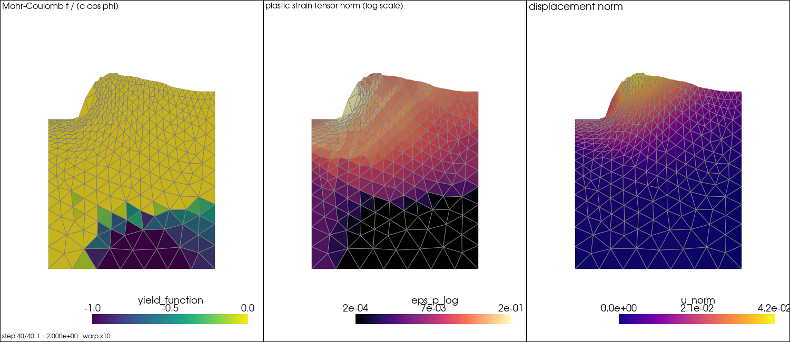

# Strip footing on a Mohr–Coulomb soil (plane strain)

Bearing capacity of a strip footing on a cohesive-frictional, weightless soil. By symmetry
half of the problem is modelled (`mesh_data/half_footing_2x2_b02_size01.msh`, 356 nodes,
639 T3 elements, from pytripopfem):

- soil [0, 2] × [0, 2]; bottom edge (`Dirichlet BC1`): v_y = 0; lateral edges
  (`Dirichlet BC2`, `Dirichlet BC3`, the left one being the symmetry axis): v_x = 0;
- smooth rigid footing of half-width 0.2 on the top edge (`Forces`): v_y = −0.01 (constant,
  displacement control);
- E = 1e7 Pa, ν = 0.3, ρ = 1.5e3 kg/m³, plane strain, lumped mass;
- Mohr–Coulomb: cohesion c = 2 kPa, friction angle φ = 25°, dilatancy angle ψ = φ
  (associated flow) by default;
- h = 0.05, θ = 1, 40 steps (about 13 s).

The footing reaction grows and saturates near −11 900 (half footing). Prandtl's bearing
capacity of a weightless soil, q_u = c N_c (N_c = 20.72 for φ = 25°), gives −8 288 for the
half footing: the constant-strain T3 elements (stiff in plane strain plasticity) and the small
domain overestimate it. The plastic zone starts under the footing (step 1) and spreads to the
whole domain, with a heave next to the footing.



*Default mesh, end of the loading (step 40, displacements ×10): Mohr–Coulomb yield function
(0 on the yield surface), plastic strain tensor norm (log scale) and displacement magnitude;
`python3 footing_viz.py` in the directory of the outputs.*

## Meshes

- `mesh_data/half_footing_2x2_b02_size01.msh` (default, used by the test and the comparison
  with pytripopfem): 639 T3, 6 element edges under the footing;
- `mesh_data/half_footing_graded.msh`: 441 T3, graded towards the edge of the footing (stress
  singularity) and along it, generated with gmsh 4.14 from `half_footing_graded.geo`
  (parameters `h_min` = 0.02 at the edge of the footing, `h_max` = 0.25, domain size
  `L` = 2, footing half-width `b` = 0.2):

  ```bash
  gmsh -2 -format msh22 half_footing_graded.geo -o half_footing_graded.msh
  gmsh -2 -format msh22 -setnumber h_min 0.01 -setnumber L 4 half_footing_graded.geo -o finer.msh
  ```

The mesh is the first argument of the example, e.g. `./footing
mesh_data/half_footing_graded.msh`. Footing reaction at the end of the loading (step 40,
settlement 0.02), macOS arm64:

| mesh | T3 | edges under the footing | reaction | time (40 steps) |
|---|---|---|---|---|
| default (uniform) | 639 | 6 | −11 897 | 13 s |
| graded, h_min = 0.04 | 305 | 4 | −12 955 | 3.8 s |
| graded, h_min = 0.02 (bundled) | 441 | 7 | −11 326 | 9.0 s |
| graded, h_min = 0.01 | 739 | 13 | −10 646 | 39 s |
| graded, h_min = 0.02, L = 4 | 1529 | 7 | −10 493 | 114 s |

The reaction decreases with the refinement and with the size of the domain, towards Prandtl's
−8 288 but slowly: the constant-strain T3 elements are too stiff for the plastic flow in plane
strain (higher-order or mixed elements would be needed to approach the collapse load), and the
reaction still grows by ~1 % between steps 30 and 40. The cost grows faster than the number of
elements (dense matrices of the kernel, see `docs/devel/FEM_PLASTICITY_SCHEME.md`).

## Model

- `SolidLinearTIDS` (unknowns v and the element stresses, `MassType::lumped`,
  `Material(ρ, E, ν, AnalysisType2D::plane_strain)`);
- one `StressLinearTIR` per element, `C = elementStressSelection(e)` (its output is the
  physical stress of the element), with a
  `DruckerPragerPlasticityNSL::mohrCoulombPlaneStrain(c, φ, ψ)`: R ≤ −p sin φ + c cos φ (R the
  radius of the Mohr circle, p the in-plane mean stress), i.e. the cone ‖σ_T‖ ≤ η σ_N + c' of
  the numerics `PlasticityProblem` with η = sin φ, c' = √2 c cos φ, and the dilatancy parameter
  θ = sin φ − sin ψ;
- `fem::integrators::MoreauJeanGOSI` and `fem::nonsmooth_formulations::Plasticity`: the global
  problem is condensed on the stresses and solved by the global semi-smooth Newton
  `PLASTICITY_2D_NSN` (tolerance 1e-10, 7–13 iterations per step; NSGS reaches an error of
  3e-4 after 2e4 sweeps on these problems).

The results agree with the pytripopfem code (same mesh, native T3 backend, its semi-smooth
Newton solver) to round-off (relative differences ≤ 7e-12 on the displacements, 3e-11 on
the stresses, 4e-13 on the footing reaction), for ψ = φ and for ψ = 10° (non-associated
flow), see `docs/devel/FEM_PLASTICITY_SCHEME.md`
(siconos repository).

Usage: `./footing [mesh [ψ in degrees]]`, e.g. `./footing
mesh_data/half_footing_2x2_b02_size01.msh 10` (the reference comparison is done for the
default case only).

## Outputs

- `footing.dat`, one line per step: t, u_y of the footing, footing reaction, max of the
  yield function f / (c cos φ) (f = R + p sin φ − c cos φ ≤ 0), number of plastic elements,
  max tensor norm ‖ε_p‖ of the plastic strain (compared with `footing.ref`);
- for the visualization: `footing_nodes.dat` (x, y, dofs of u_x and u_y),
  `footing_triangles.dat` (node indices) and the histories, one line per step from the
  initial state: `footing_u.dat` (displacements, dof order), `footing_sigma.dat`,
  `footing_eps_p.dat` (physical stresses and plastic strains, 3 per element, Mandel notation).

Stresses and strains are in Mandel notation, as the unknowns of `SolidLinearTIDS`:
σ = (σxx, σyy, √2 σxy), ε = (εxx, εyy, √2 εxy). The basis is orthonormal: σ·ε is the work
and the Euclidean norm is the tensor norm, ‖ε_p‖ = √(εxx² + εyy² + 2 εxy²). Divide the third
component by √2 to get σxy (εxy).

## Visualization (pyvista)

`footing_viz.py` shows, on the deformed mesh, the yield function f / (c cos φ) (−1 for a
stress-free element, 0 on the yield surface), the tensor norm of the plastic strain (log scale over
`--eps-decades` decades, default 3, below the 98th percentile of the last step or
`--eps-max`: the strain is concentrated at the edge of the footing) and the displacement
magnitude, with colour scales fixed over the whole history. Run it in the
directory of the simulation outputs (or give it with `--dir`):

```bash
python3 footing_viz.py                    # last step -> footing_040.png
python3 footing_viz.py --step 2           # onset of plasticity under the footing
python3 footing_viz.py --gif              # all steps -> footing.gif (imageio)
python3 footing_viz.py --show             # interactive window
```

`--cohesion` and `--phi` must match the simulation. It needs `pyvista` (and `imageio` for
`--gif`); it is not run by the tests.

Load–displacement curve:

```python
import numpy as np
import matplotlib.pyplot as plt

d = np.loadtxt("footing.dat")
plt.plot(-d[:, 1], -d[:, 2])
plt.axhline(8288, ls="--", label="Prandtl (half footing)")
plt.xlabel("settlement")
plt.ylabel("footing reaction")
plt.legend()
plt.show()
```
